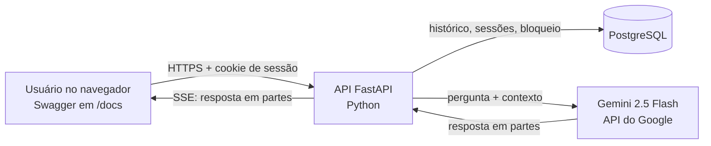
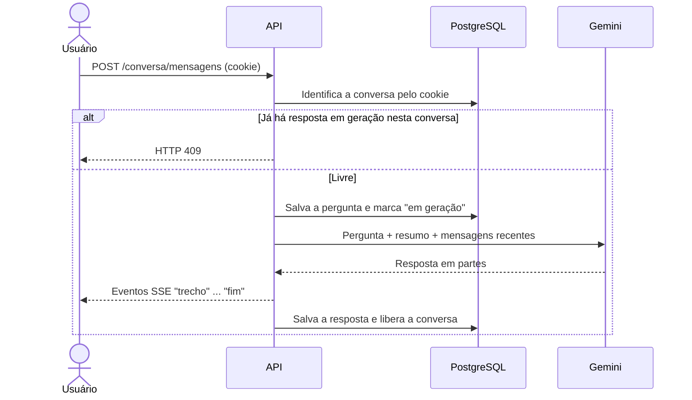

# Resumo da implementação — Chatbot TCA

> Situação em **14/11/2026**, branch `dev`. Apresentação: **segunda-feira, 16/11**.
>
> **Em uma frase:** o backend está completo e testado, usando o Gemini 2.5 Flash; falta publicar
> a aplicação no AWS EC2 (com endereço público) e implementar o monitoramento (RF09), que ficaram
> com a parte de infraestrutura.

## Placar dos requisitos do professor

Base: [`docs/requisitos.md`](requisitos.md) (22 itens).

| ✅ Atendidos | ◐ Parciais | ❌ Pendentes |
|:---:|:---:|:---:|
| **15** | **4** | **3** |

| Grupo | Situação |
|---|---|
| Funcionalidades principais (multiusuário, ID único, histórico isolado, LLM, resposta ao usuário certo) | ✅ 5 de 5 |
| Implementação (modelo, framework, backend) | ✅ 3 de 3 |
| Publicação e infraestrutura | ◐ EC2 (instância criada, sem a aplicação) · ❌ endereço público · ◐ instruções de uso (falta só a URL pública) |
| Critérios de avaliação | ✅ multiusuário · ✅ sessões · ✅ organização do código · ✅ qualidade das respostas · ◐ EC2 · ❌ acesso público · ❌ apresentação (segunda) |
| Observações | ✅ ID único · ✅ conexões concorrentes · ✅ justificativa técnica · ◐ GitHub (`dev` publicada; `main` só tem o commit inicial) |

**Tudo o que está pendente depende do deploy** (ou é a própria apresentação).

## Arquitetura

| Peça | Tecnologia | Onde fica |
|---|---|---|
| API | Python + FastAPI (documentação Swagger automática) | `app/` |
| Banco | PostgreSQL (SQLAlchemy assíncrono) | Docker local: `infra/docker-compose.yml` |
| Modelo | Gemini 2.5 Flash, pelo SDK oficial `google-genai` | Serviço do Google (crédito pré-pago) |
| Interface | Swagger (sem front-end nesta etapa) | `http://localhost:8001/docs` |
| Hospedagem | AWS EC2 `t3.micro` | **Ainda não implantada** (`infra/instancia-ec2.md`) |

## O que foi implementado

| Funcionalidade | Como funciona | Código |
|---|---|---|
| **Sessão por cookie** | Na primeira requisição, o servidor gera um ID (UUID v4) e o entrega num cookie `HttpOnly`, `Secure`, `SameSite=Lax`. O navegador o envia sozinho; ninguém copia ID. | `app/sessao.py` |
| **Uma conversa por cliente** | Cada navegador tem sua conversa. Outro navegador ou janela anônima = outro usuário. | `app/sessao.py` |
| **Cookie inválido ou expirado** | Cria uma conversa nova, sem erro. | `app/sessao.py` |
| **Histórico persistente e isolado** | Mensagens no PostgreSQL; sobrevivem a reinícios. Toda consulta filtra pela conversa do cookie. | `app/models.py`, `app/rotas.py` |
| **Respostas em tempo real (SSE)** | A resposta chega em partes (`trecho`), seguida de `fim` ou `erro`. | `app/rotas.py` |
| **Bloqueio de perguntas simultâneas** | Se a mesma conversa já está gerando uma resposta, a nova pergunta recebe **HTTP 409**. Controle atômico no banco. | `app/sessao.py` |
| **Contexto longo** | As mensagens recentes vão inteiras ao modelo; as antigas viram um resumo, atualizado em lotes. O histórico completo continua no banco. | `app/resumo.py` |
| **Retenção de 1 hora** | Conversa sem atividade por 1 hora é apagada por uma rotina periódica. | `app/retencao.py` |
| **Integração com o Gemini** | Streaming assíncrono, raciocínio desligado para responder mais rápido. Sem chave configurada, a aplicação não inicia e explica o motivo. | `app/llm.py` |
| **Configuração por `.env`** | Banco, cookie, modelo e chave. A chave nunca vai para o GitHub. | `app/config.py`, `.env.example` |

### Endpoints

| Endpoint | O que faz |
|---|---|
| `GET /conversa` | Mostra o histórico da conversa (cria a conversa, se ainda não existir). |
| `POST /conversa/mensagens` | Envia `{"pergunta": "..."}` e recebe a resposta por SSE. |
| `GET /saude` | Indica se a aplicação está no ar. |

### Fluxo de uma pergunta

## Modelo: Gemini 2.5 Flash

**Por quê:** respostas de qualidade (critério de avaliação), baixa latência, roda no Google (o
EC2 pequeno não precisa rodar o modelo) e é citado no enunciado. Antes, a equipe testou o Qwen 3
local (Ollama); ele errou fatos simples e não cabia na instância, por isso foi substituído.

**Medições reais (14/11/2026, um usuário):**

| Métrica | Resultado | Meta aprovada |
|---|---|---|
| Tempo até o primeiro trecho (TTFT) | **0,45 s a 0,94 s** | mediana ≤ 2 s ✅ |
| Tempo total da resposta | **0,6 s a 1,3 s** | p95 ≤ 30 s ✅ |
| Qualidade | "A capital do Piauí é Teresina" ✅ (o Qwen 3 errou) | — |
| Memória da conversa | "Seu nome é Ana e você mora em Teresina" ✅ | — |
| Isolamento | Outro usuário não vê a conversa ✅ | — |

**Custos:** crédito **pré-pago de R$ 30**, sem recarga automática. Cada pergunta custa uma
fração de centavo; o crédito cobre com folga as duas apresentações previstas. Se acabar, a API
para de responder, sem cobrança extra. O teste de carga com 30 usuários **não será feito**, para
poupar o crédito.

## Testes

**19 testes automatizados, todos passando.** Rodam sem chave nem internet (usam um modelo
simulado) e num banco separado.

| Área | O que cobrem |
|---|---|
| Sessão | Criação do cookie e seus atributos, reuso, cookie inválido, ID inexistente, ID fora das respostas |
| Isolamento | Dois usuários com conversas separadas |
| Concorrência | 409 durante a geração, bloqueio abandonado, liberação após resposta e após falha do modelo |
| Retenção | Conversa expirada vira nova; limpeza apaga as inativas |
| Contexto | Resumo em lotes e contexto enviado ao modelo |
| Gemini | Conversão das mensagens, falta de chave, raciocínio desligado |

Além disso, a aplicação foi testada de ponta a ponta com o Gemini de verdade.

## Principais decisões

Todas, com os motivos, estão em [`docs/elicitação dos requisitos.md`](elicitação%20dos%20requisitos.md) (seção 9).

| Decisão | Escolha |
|---|---|
| Interface | API + Swagger, sem front-end nesta etapa |
| Identificação do usuário | Cookie de sessão (não IP, não `localStorage`) |
| Conversas por cliente | Uma |
| Pergunta durante outra resposta | Recusada (HTTP 409) |
| Contexto longo | Mensagens recentes + resumo das antigas |
| Retenção | 1 hora sem atividade |
| Entrega da resposta | Streaming por SSE |
| Modelo | Gemini 2.5 Flash, crédito pré-pago |
| Teste de carga | Não será feito |

## O que falta

| Item | Responsável | Referência |
|---|---|---|
| **Deploy no EC2**: liberar portas 80 e 443, instalar Docker, HTTPS, `.env` do servidor com a chave | Infraestrutura | `infra/instancia-ec2.md` (checklist) |
| **Monitoramento (RF09)**: TTFT, tempo total, erros, CPU e RAM | Infraestrutura | Requisito RF09 em `docs/elicitação dos requisitos.md` |
| **URL pública no README** | Infraestrutura | Seção "Acesso público" do README |
| **Levar a `dev` para a `main`** | Equipe | — |
| Mensagem específica quando o crédito ou o limite do Gemini acabar (erro 429) | Equipe (opcional) | Questão em aberto 2 |
| Trocar o modelo se houver apresentação depois de 1º/12 (o 2.5 Flash será substituído pelo Google) | Equipe | Questão em aberto 3 |

## Como rodar

Passo a passo completo no [`README.md`](../README.md): subir o banco com Docker, criar o `.venv`,
colocar a chave do Gemini no `.env` e iniciar com `uvicorn app.main:app --port 8001`.
