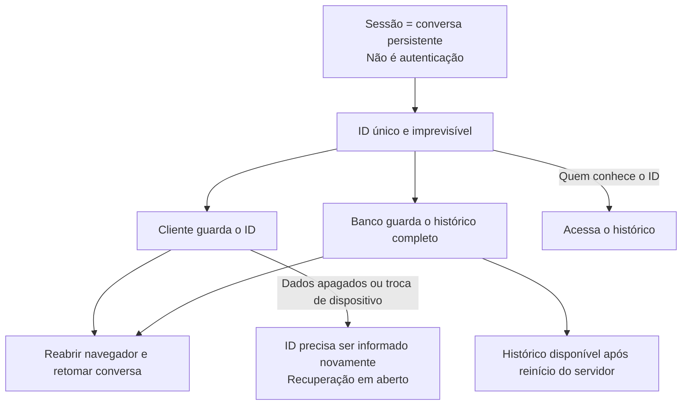
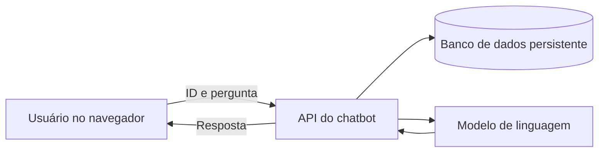
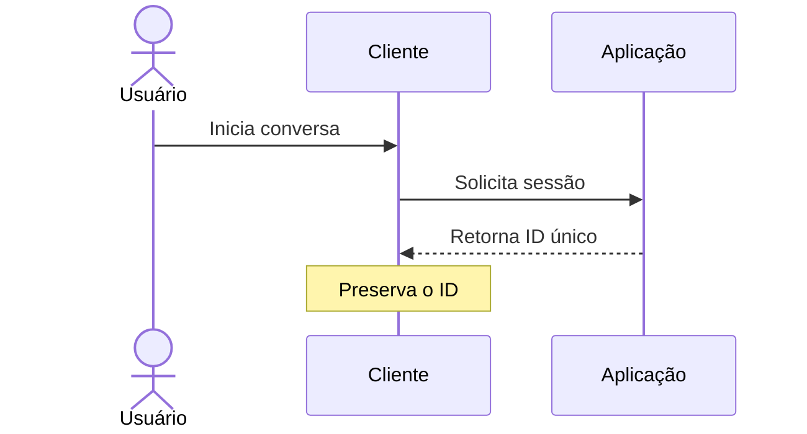
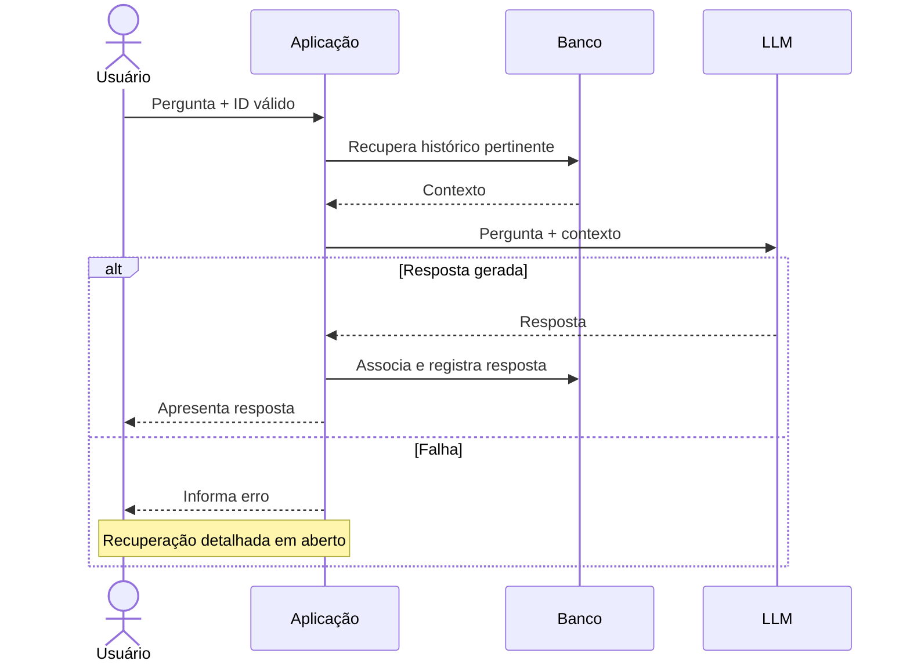
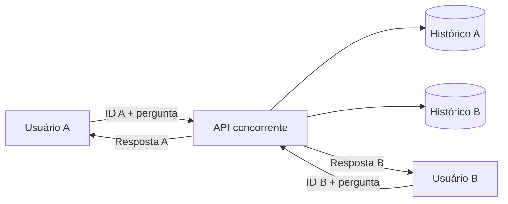
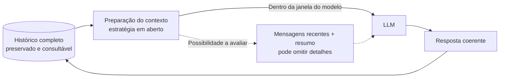
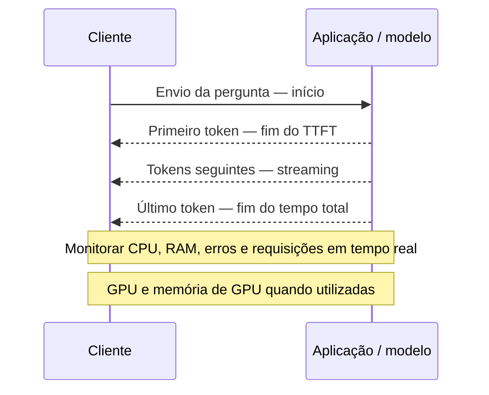
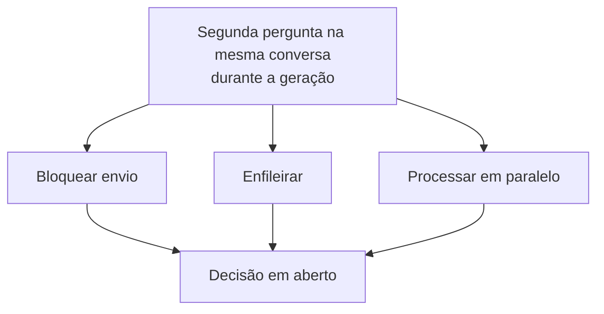

# Elicitação dos requisitos — Chatbot multiusuário

## 1. Objetivo e escopo

Desenvolver um protótipo de chatbot que responda perguntas genéricas usando um modelo de linguagem (LLM), atendendo simultaneamente dezenas de usuários. Cada conversa deve ter histórico próprio e persistente, acessível após o fechamento do navegador e após o desligamento ou reinício do servidor.

Este documento formaliza os requisitos discutidos a partir de `requisitos.md`. Pontos ainda não definidos são identificados como decisões em aberto; critérios quantitativos propostos não são metas aprovadas.

## 2. Conceito de sessão

Neste projeto, **sessão é uma conversa persistente**, identificada por um ID único. Não se trata de sessão de autenticação: não há login ou identidade verificada no escopo atual, conforme orientação do professor.

O cliente guarda o ID para reencontrar a conversa após o fechamento do navegador. O servidor guarda o histórico em banco de dados persistente. Ao retornar, o usuário pode continuar a conversa de onde parou.

O ID é a chave de acesso à conversa: quem o conhecer poderá acessar seu histórico. Ele deve ser imprevisível e protegido em trânsito por HTTPS. Se os dados locais forem apagados ou o usuário trocar de dispositivo, o cliente deixa de conhecer o ID; recuperá-lo pressupõe que ele tenha sido guardado e possa ser informado novamente. O mecanismo de recuperação ainda precisa ser definido.

## 3. Atores e visão geral

- **Usuário:** inicia ou retoma uma conversa e envia perguntas.
- **Desenvolvedor ou avaliador:** utiliza e verifica a API pública conforme sua documentação.
- **Modelo de linguagem:** processa a pergunta e o contexto fornecido pela aplicação.

## 4. Requisitos funcionais

| ID | Requisito | Critério de aceitação |
|---|---|---|
| RF01 | Criar uma conversa com ID único. | Ao iniciar uma conversa, o cliente recebe um ID associado a um histórico próprio. |
| RF02 | Preservar a identificação da conversa no cliente. | Após fechar e reabrir o navegador no mesmo dispositivo, o usuário consegue retomar a conversa enquanto os dados locais forem mantidos. |
| RF03 | Persistir o histórico completo no servidor. | Mensagens confirmadas como salvas continuam disponíveis após reinicialização da aplicação ou da máquina. |
| RF04 | Permitir continuidade da conversa. | O usuário pode consultar o histórico completo e enviar novas perguntas à mesma conversa. |
| RF05 | Responder perguntas genéricas usando um LLM. | Cada pergunta válida é encaminhada ao processamento e a resposta é devolvida à conversa correspondente, ou uma falha é comunicada. |
| RF06 | Atender múltiplos usuários concorrentemente. | Dezenas de usuários podem interagir sem mistura de históricos ou respostas; a capacidade exata será medida. |
| RF07 | Informar falhas ao usuário. | Falhas são comunicadas; o texto das mensagens e as ações de recuperação serão definidos. |
| RF08 | Disponibilizar e documentar a API publicamente. | Um avaliador consegue acessar e utilizar o endpoint seguindo a documentação. |
| RF09 | Monitorar desempenho e recursos. | TTFT, tempo de resposta completa e recursos da máquina podem ser acompanhados, inclusive em tempo real. |

## 5. Casos de uso

### UC01 — Iniciar conversa

**Ator:** usuário. **Fluxo:** o usuário inicia uma conversa; a aplicação cria uma sessão, retorna seu ID e o cliente o preserva. **Resultado:** existe uma conversa própria disponível para receber perguntas.

### UC02 — Enviar pergunta e receber resposta

**Ator:** usuário. **Pré-condição:** o cliente dispõe de um ID de conversa válido. **Fluxo:** o usuário envia a pergunta; a aplicação recupera o contexto pertinente, consulta o LLM, associa e registra a resposta na conversa e a apresenta ao usuário. **Alternativa:** em caso de falha, a aplicação informa o erro. O comportamento detalhado de recuperação permanece em aberto.

### UC03 — Retomar conversa

**Ator:** usuário. **Pré-condição:** o ID continua disponível no cliente e o histórico foi persistido. **Fluxo:** após reabrir o navegador, a aplicação usa o ID para recuperar o histórico; o usuário consulta as mensagens e continua a conversa. O mesmo histórico deve continuar disponível após reinício do servidor.

### UC04 — Interagir simultaneamente

**Atores:** vários usuários. **Fluxo:** usuários enviam perguntas em suas respectivas conversas ao mesmo tempo. **Resultado:** cada resposta é associada à conversa e à requisição corretas, sem acesso a históricos de outras conversas.

### UC05 — Consultar a API

**Ator:** desenvolvedor ou avaliador. **Fluxo:** consulta a documentação e utiliza o endpoint público. **Resultado:** consegue criar ou retomar uma conversa e enviar perguntas conforme as operações disponibilizadas.

## 6. Invariantes

1. Cada conversa tem um ID único e um histórico próprio.
2. Uma conversa não pode acessar ou alterar o histórico de outra.
3. Uma resposta concluída pertence à pergunta e à conversa que a originaram.
4. Mensagens confirmadas como salvas permanecem disponíveis após reinício do servidor.
5. O histórico completo é preservado, mesmo quando apenas parte dele puder ser enviada ao modelo.
6. Falhas são comunicadas como falhas, sem serem apresentadas como respostas geradas pelo modelo.
7. O ID é tratado como informação sensível, pois dá acesso ao histórico. Credenciais do provedor do modelo também devem permanecer protegidas e fora do repositório público.

## 7. Histórico e contexto do modelo

O histórico integral deve ser armazenado e ficar disponível para consulta. Já a quantidade de mensagens que pode ser enviada ao modelo em cada chamada depende de sua janela de contexto. Conversas longas podem exceder esse limite ou elevar custo e latência.

A conversa deve continuar de forma coerente. A estratégia para preparar o contexto quando ele exceder o limite do modelo permanece em aberto. Uma possibilidade é combinar mensagens recentes com um resumo das anteriores, preservando o histórico integral no banco; essa opção pode omitir detalhes no contexto e deve ser avaliada. Não foi estabelecido que todas as mensagens devam ser enviadas integralmente ao modelo a cada pergunta.

## 8. Qualidade, monitoramento e infraestrutura

- **Concorrência:** projetar e avaliar para dezenas de usuários; a quantidade exata e o padrão de carga ainda serão definidos.
- **Tempo até o primeiro token (TTFT):** medir o intervalo entre o envio da pergunta e o recebimento do primeiro token. Para que o usuário observe a resposta progressivamente, será necessário um mecanismo de streaming.
- **Tempo total de resposta:** medir o intervalo entre o envio da pergunta e o recebimento do último token.
- **Recursos:** acompanhar CPU e RAM da máquina, inclusive em tempo real; acompanhar GPU e sua memória se utilizadas. Medir o consumo do próprio modelo quando ele executar na infraestrutura sob controle da equipe.
- **Erros e carga:** acompanhar falhas e requisições em andamento para relacionar desempenho à concorrência.
- **Modelo externo:** se uma API de terceiros executar o modelo, o consumo de recursos dessa execução pode não estar disponível; ainda assim, é possível medir recursos locais e latências percebidas.
- **Segurança e privacidade:** proteger o tráfego com HTTPS, guardar credenciais no servidor e considerar a exposição de conteúdo enviado ao provedor. O ID não comprova a identidade do usuário.
- **Hospedagem:** EC2 é preferencial. Conforme o enunciado, sua utilização é opcional e concede pontuação extra; o endpoint público e as instruções de uso são exigidos.
- **Tecnologia:** a escolha do LLM, da API de desenvolvimento e da stack de backend é livre e deve ser justificada tecnicamente.

Não foram aprovadas metas numéricas de TTFT, tempo total, disponibilidade ou consumo de recursos. Essas métricas devem ser medidas antes da definição de eventuais limites de aceitação.

## 9. Decisões e questões em aberto

1. **Perguntas simultâneas na mesma conversa:** decidir se o segundo envio será bloqueado, enfileirado ou processado em paralelo enquanto a primeira resposta é gerada. A decisão permanece aberta; bloquear ou enfileirar pode tornar a ordem mais previsível.
2. **Falhas:** definir mensagens e ações para ID inexistente, entrada vazia, indisponibilidade ou demora do modelo e outros erros pertinentes.
3. **Contexto longo:** definir a estratégia quando o histórico ultrapassar a janela do modelo, incluindo os impactos sobre a continuidade.
4. **Metas de desempenho:** definir quantidade exata de usuários simultâneos, cenário de carga e valores aceitáveis para TTFT e tempo total.
5. **Recuperação do ID:** definir como o usuário poderá reencontrar a conversa após apagar os dados locais ou trocar de dispositivo.
6. **Retenção e exclusão:** definir por quanto tempo os dados permanecem armazenados e se haverá exclusão de conversas.
7. **Implantação e modelo:** escolher e justificar provedor/modelo, stack, banco, mecanismo de streaming e infraestrutura definitiva.

## 10. Verificação e apresentação

Um cenário de demonstração é abrir duas conversas simultâneas, informar um dado diferente em cada uma e perguntar em seguida qual dado foi informado. Isso permite verificar continuidade de contexto e isolamento. Também devem ser demonstrados o retorno após fechar o navegador, a recuperação após reiniciar o servidor, o acesso público e o acompanhamento das métricas.

Conforme o enunciado, o código-fonte deve ser publicado em repositório GitHub. A apresentação do protótipo será presencial, em 11 de novembro, com 30 minutos por equipe; o ano não está especificado no arquivo de origem.
