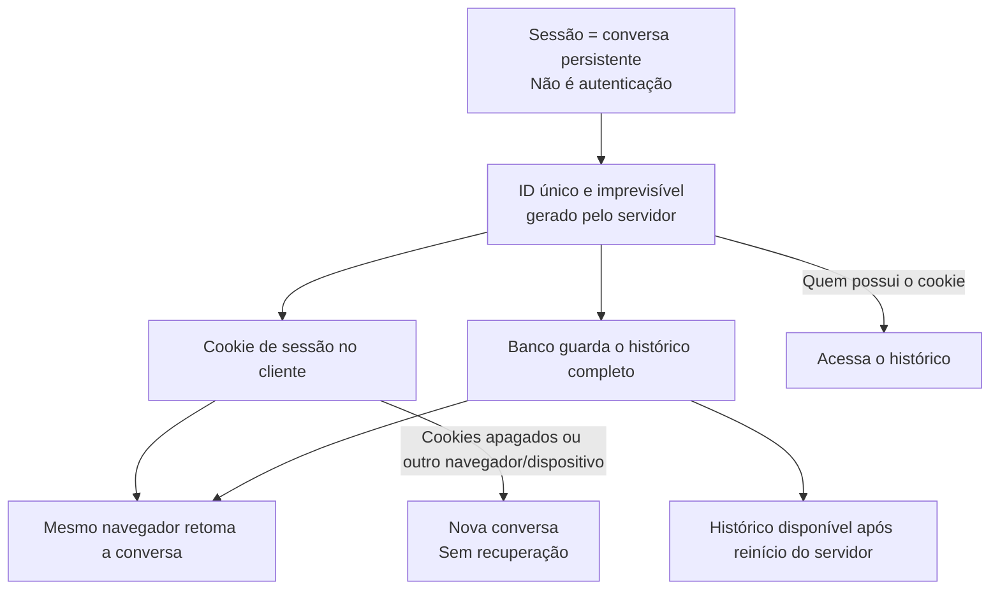
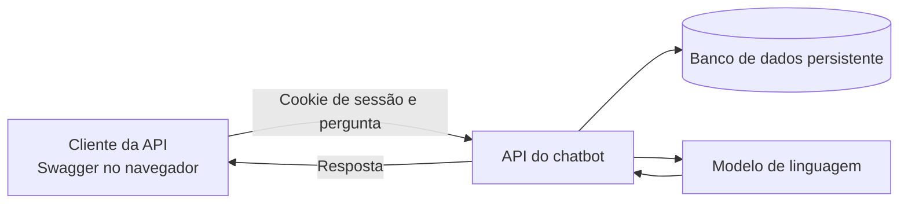
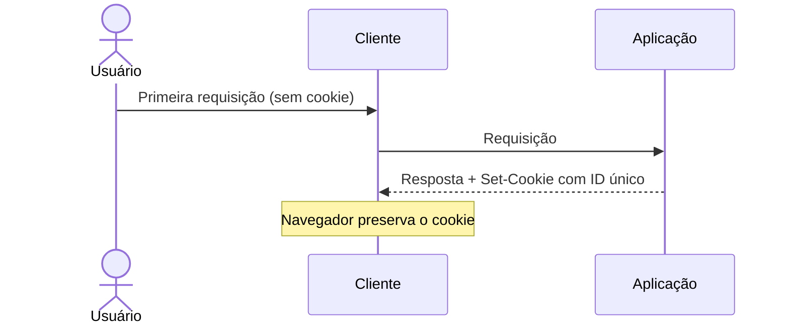
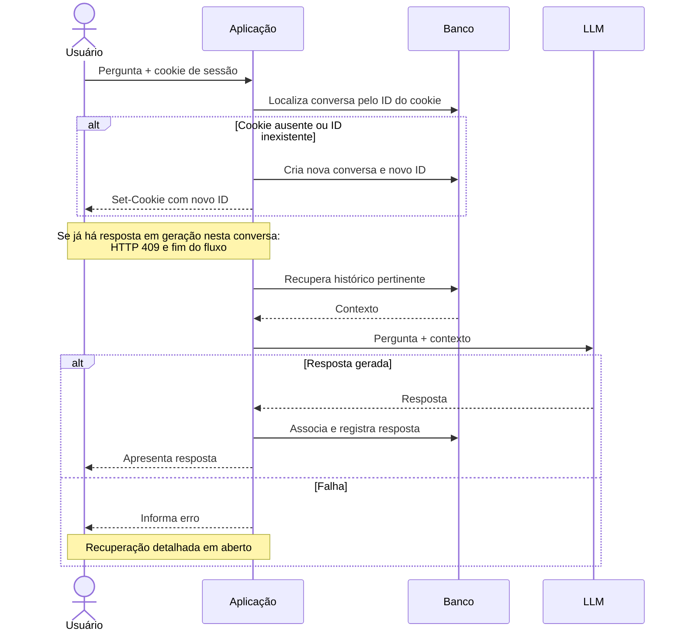
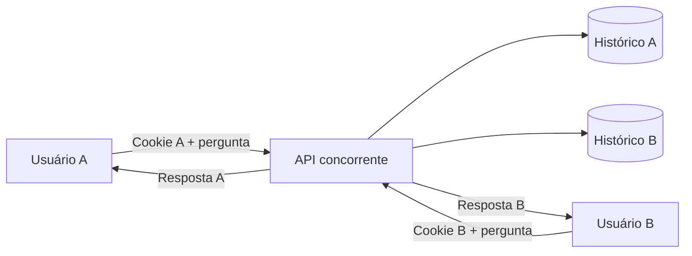
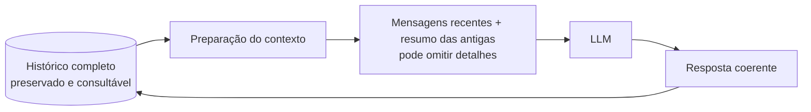
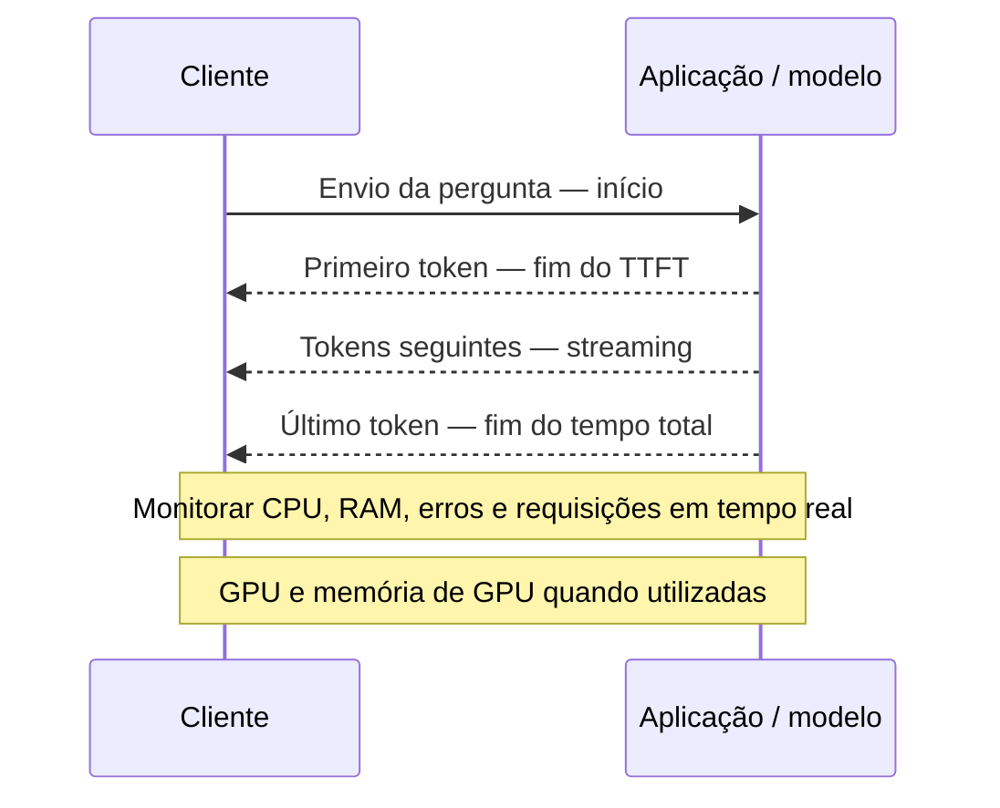
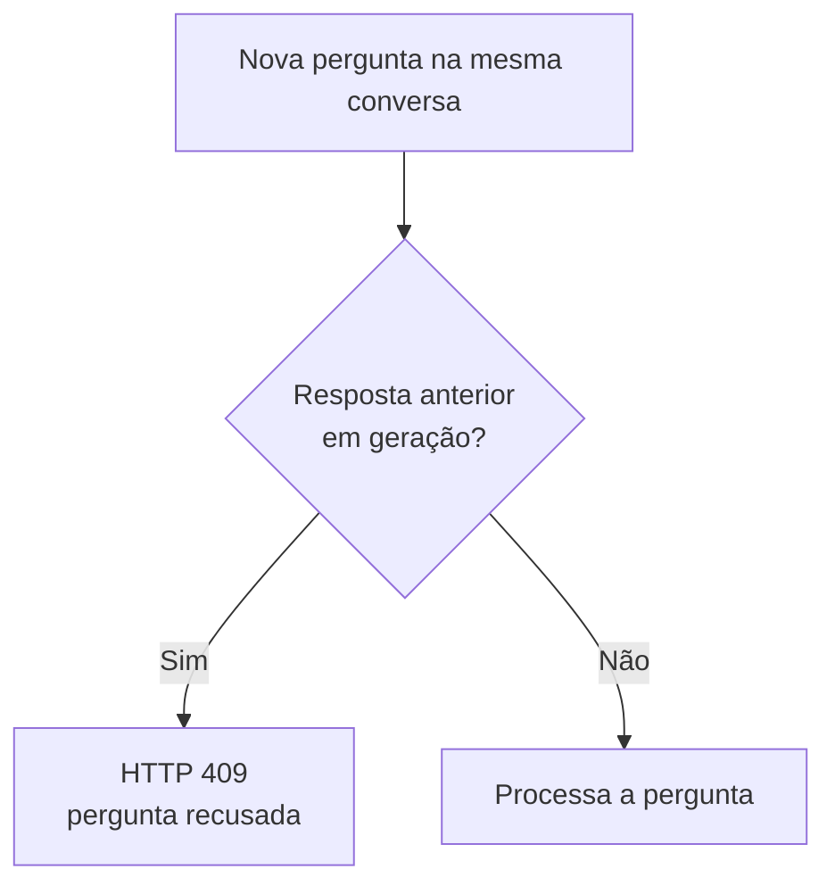

# Elicitação dos requisitos — Chatbot multiusuário

## 1. Objetivo e escopo

Desenvolver um protótipo de chatbot que responda perguntas genéricas usando um modelo de linguagem (LLM), atendendo simultaneamente dezenas de usuários. Cada conversa deve ter histórico próprio e persistente, acessível após o fechamento do navegador e após o desligamento ou reinício do servidor, durante o período de retenção de 1 hora (ver seção 9).

Este documento formaliza os requisitos discutidos a partir de `requisitos.md`. Pontos ainda não definidos são identificados como decisões em aberto; critérios quantitativos propostos não são metas aprovadas.

## 2. Conceito de sessão

Neste projeto, **sessão é uma conversa persistente**, identificada por um ID único. Não se trata de sessão de autenticação: não há login ou identidade verificada no escopo atual, conforme orientação do professor.

Cada cliente tem **uma única conversa**. O servidor gera o ID quando o cliente se conecta pela primeira vez e o entrega em um cookie de sessão; o navegador o devolve automaticamente nas requisições seguintes, e o servidor o usa para localizar a conversa. O servidor guarda o histórico em banco de dados persistente. Ao retornar, o usuário continua a conversa de onde parou, sem copiar ou informar o ID manualmente.

O ID é a chave de acesso à conversa: quem o conhecer ou possuir o cookie poderá acessar seu histórico. Ele deve ser imprevisível e protegido em trânsito por HTTPS. Se os cookies forem apagados ou o usuário trocar de navegador ou dispositivo, o cliente deixa de apresentar o ID e uma nova conversa será iniciada; a conversa anterior fica inacessível e é removida pela política de retenção. Não haverá mecanismo de recuperação (ver seção 9).

### Decisões tomadas

1. **Interface: a própria API HTTP, usada pelo Swagger/OpenAPI.**
   - *Decisão:* não haverá front-end nesta etapa; `curl` e Postman são alternativas opcionais. Um front-end poderá ser feito depois.
   - *Motivo:* o professor dispensou o front-end, e o Swagger dá ao avaliador uma forma de testar a API pelo navegador, sem escrever código, o que atende o RF08.
2. **Identificação do cliente por cookie de sessão (aprovada).**
   - *Decisão:* o servidor gera o ID na primeira requisição e o entrega em cookie; o navegador o devolve automaticamente.
   - *Motivo:* o IP não distingue usuários atrás do mesmo NAT (como a rede da UFPI) e muda com a rede; o `localStorage` exigiria um front-end ou a cópia manual do ID a cada chamada; o cookie é enviado sozinho pelo navegador, inclusive pelo Swagger, e corresponde ao enunciado, que fala em ID gerado no instante em que o cliente HTTP se conecta.
3. **Uma conversa por cliente.**
   - *Decisão:* não há operação para criar várias conversas nem para alternar entre elas. O ID não aparece nas URLs. Abas do mesmo navegador compartilham a conversa; navegadores diferentes, janelas anônimas e outros dispositivos têm conversas distintas.
   - *Motivo:* o enunciado fala em "cada usuário" com "um id único" e não pede várias conversas por pessoa. Isso simplifica a API (sem listar nem escolher conversas), evita expor IDs na URL e reduz o risco de vazamento.
4. **Atributos do cookie: `HttpOnly`, `Secure`, `SameSite=Lax` e validade de 1 hora, renovada a cada requisição.**
   - *Motivo:* o ID dá acesso ao histórico. `HttpOnly` impede que um script da página o leia (XSS); `Secure` o mantém só em HTTPS, como exigem os requisitos de segurança; `SameSite=Lax` reduz o risco de requisições forjadas de outros sites; a validade de 1 hora acompanha o período de retenção das conversas (seção 9), pois um cookie que durasse mais apontaria para uma conversa já removida.
5. **Geração do ID pelo servidor, com gerador criptográfico (por exemplo, UUID v4).**
   - *Motivo:* o ID é o único segredo de acesso, então precisa ser imprevisível. IDs sequenciais poderiam ser adivinhados, e um ID escolhido pelo cliente permitiria colisões ou o sequestro de conversas.
6. **Clientes sem navegador mantêm os cookies entre chamadas.**
   - *Decisão:* `curl` e scripts usam um arquivo de cookies (por exemplo, `curl -c cookies.txt -b cookies.txt`); testes de carga usam um conjunto de cookies por usuário simulado.
   - *Motivo:* sem isso, cada chamada seria vista como um cliente novo, e todas as requisições de um teste de carga criariam conversas diferentes ou se misturariam numa só.
7. **Cookie ausente ou com ID inexistente: o servidor cria uma nova conversa.**
   - *Decisão:* nos dois casos, o servidor gera um novo ID, cria a conversa vazia e envia o novo cookie. A conversa anterior, se existir, fica inacessível a esse cliente e é removida ao fim do período de retenção (1 hora sem atividade).
   - *Motivo:* sem login, não há como recuperar a conversa antiga nem confirmar quem é o cliente, e o usuário perde o cookie ao limpá-los ou trocar de navegador. Criar uma nova conversa deixa a API sempre utilizável, sem exigir que o usuário trate um erro, e trata o ID inexistente (por exemplo, após limpar o banco) do mesmo jeito que o cookie ausente. Contrapartida: o usuário perde o acesso à conversa anterior, o que é consistente com a decisão de não haver recuperação (seção 9).

## 3. Atores e visão geral

- **Usuário:** inicia ou retoma sua conversa e envia perguntas.
- **Desenvolvedor ou avaliador:** utiliza e verifica a API pública conforme sua documentação.
- **Modelo de linguagem:** processa a pergunta e o contexto fornecido pela aplicação.

## 4. Requisitos funcionais

| ID | Requisito | Critério de aceitação |
|---|---|---|
| RF01 | Criar uma conversa com ID único para cada novo cliente. | Na primeira requisição de um cliente sem cookie de sessão, ou com cookie cujo ID não exista no banco, o servidor gera o ID, cria o histórico próprio e entrega o ID em cookie. |
| RF02 | Reconhecer o cliente pelo cookie de sessão e associá-lo à sua única conversa. | Enquanto o cookie existir, requisições do mesmo cliente acessam a mesma conversa, inclusive após fechar o navegador e após reinício do servidor; o ID não precisa ser informado manualmente. |
| RF03 | Persistir o histórico completo no servidor. | Mensagens confirmadas como salvas continuam disponíveis após reinicialização da aplicação ou da máquina, enquanto a conversa estiver dentro do período de retenção. |
| RF04 | Permitir continuidade da conversa. | O usuário pode consultar o histórico completo e enviar novas perguntas à sua conversa. |
| RF05 | Responder perguntas genéricas usando um LLM. | Cada pergunta válida é encaminhada ao processamento e a resposta é devolvida à conversa correspondente, ou uma falha é comunicada. |
| RF06 | Atender múltiplos usuários concorrentemente. | Dezenas de usuários podem interagir sem mistura de históricos ou respostas; a capacidade exata será medida. |
| RF07 | Informar falhas ao usuário. | Falhas são comunicadas; o texto das mensagens e as ações de recuperação serão definidos. Cookie ausente ou com ID inexistente não é falha: gera nova conversa (RF01, decisão 7). |
| RF08 | Disponibilizar e documentar a API publicamente. | Um avaliador consegue acessar e utilizar o endpoint seguindo a documentação. |
| RF09 | Monitorar desempenho e recursos. | TTFT, tempo de resposta completa e recursos da máquina podem ser acompanhados, inclusive em tempo real. |
| RF10 | Bloquear perguntas simultâneas na mesma conversa. | Enquanto a resposta a uma pergunta está sendo gerada, nova pergunta da mesma conversa é recusada com HTTP 409 (Conflict) e mensagem clara, sem ser enfileirada nem processada. Perguntas de outras conversas não são afetadas. |
| RF11 | Remover conversas inativas. | Conversa sem atividade por mais de 1 hora tem histórico e ID removidos. Um cookie com esse ID passa a ser tratado como ID inexistente (RF01). |

## 5. Casos de uso

### UC01 — Iniciar conversa

**Ator:** usuário. **Fluxo:** o usuário faz a primeira requisição sem cookie de sessão; a aplicação cria a conversa, gera o ID e o entrega em cookie, que o navegador preserva. **Alternativa (decisão 7):** se a requisição chegar com cookie cujo ID não existe no banco, a aplicação trata como cliente novo: cria uma nova conversa, gera novo ID e substitui o cookie, sem retornar erro. **Resultado:** existe uma conversa própria disponível para receber perguntas.

### UC02 — Enviar pergunta e receber resposta

**Ator:** usuário. **Fluxo:** o usuário envia a pergunta; a aplicação identifica a conversa pelo cookie de sessão, recupera o contexto pertinente, consulta o LLM, associa e registra a resposta na conversa e a apresenta ao usuário. **Alternativa 1 (decisão 7):** se o cookie estiver ausente ou seu ID não existir no banco, a aplicação cria uma nova conversa (como no UC01), emite novo cookie e processa a pergunta nela, sem retornar erro; o contexto enviado ao modelo contém apenas essa pergunta. **Alternativa 2 (decisão de bloqueio, seção 9):** se já houver uma resposta em geração nesta conversa, a aplicação recusa a nova pergunta com HTTP 409 e mensagem clara, sem enfileirá-la; o usuário pode reenviar após a conclusão da resposta em andamento. **Alternativa 3:** em caso de falha do modelo ou outra falha, a aplicação informa o erro. O comportamento detalhado de recuperação permanece em aberto.

### UC03 — Retomar conversa

**Ator:** usuário. **Pré-condição:** o cliente ainda possui o cookie de sessão e o histórico foi persistido. **Fluxo:** a aplicação lê o ID do cookie e recupera o histórico; o usuário consulta as mensagens e continua a conversa. O mesmo histórico deve continuar disponível após reinício do servidor. **Alternativa (decisão 7):** se o cookie estiver ausente ou seu ID não existir no banco, a aplicação cria uma nova conversa, emite novo cookie e apresenta o histórico vazio, sem retornar erro; a conversa anterior não é recuperada.

### UC04 — Interagir simultaneamente

**Atores:** vários usuários. **Fluxo:** usuários, cada um com seu cookie de sessão, enviam perguntas em suas respectivas conversas ao mesmo tempo. **Resultado:** cada resposta é associada à conversa e à requisição corretas, sem acesso a históricos de outras conversas.

### UC05 — Consultar a API

**Ator:** desenvolvedor ou avaliador. **Fluxo:** abre a documentação Swagger e utiliza o endpoint público. **Resultado:** consegue iniciar ou retomar sua conversa (por cookie) e enviar perguntas conforme as operações disponibilizadas.

## 6. Invariantes

1. Cada conversa tem um ID único e um histórico próprio, e cada cliente tem uma única conversa.
2. Uma conversa não pode acessar ou alterar o histórico de outra.
3. Uma resposta concluída pertence à pergunta e à conversa que a originaram.
4. Mensagens confirmadas como salvas permanecem disponíveis após reinício do servidor.
5. O histórico completo é preservado, mesmo quando apenas parte dele puder ser enviada ao modelo.
6. Falhas são comunicadas como falhas, sem serem apresentadas como respostas geradas pelo modelo.
7. O ID (e o cookie que o contém) é tratado como informação sensível, pois dá acesso ao histórico; não deve aparecer em URLs, logs públicos ou mensagens de erro. Credenciais do provedor do modelo também devem permanecer protegidas e fora do repositório público.
8. Cada conversa tem no máximo uma resposta em geração por vez.

## 7. Histórico e contexto do modelo

O histórico integral deve ser armazenado e ficar disponível para consulta. Já a quantidade de mensagens que pode ser enviada ao modelo em cada chamada depende de sua janela de contexto. Conversas longas podem exceder esse limite ou elevar custo e latência.

**Decisão:** a conversa continua de forma coerente combinando **mensagens recentes** com um **resumo das mensagens antigas**, preservando o histórico integral no banco. Motivo: o histórico completo pode exceder a janela de contexto do modelo ou elevar custo e latência; o resumo mantém o assunto da conversa sem reenviar tudo. Contrapartida: o resumo pode omitir detalhes das mensagens antigas no contexto do modelo (o histórico completo continua guardado). O bloqueio de perguntas simultâneas (seção 9) evita que dois processamentos atualizem o resumo ao mesmo tempo.

Em aberto dentro desta decisão (a definir no projeto): quantas mensagens recentes são mantidas, quando o resumo é gerado ou atualizado, qual modelo o gera e onde ele é guardado.

## 8. Qualidade, monitoramento e infraestrutura

- **Concorrência:** projetar e avaliar para algumas dezenas de usuários simultâneos (meta: 30, com teste de estresse até 50; ver metas abaixo).
- **Tempo até o primeiro token (TTFT):** medir o intervalo entre o envio da pergunta e o recebimento do primeiro token. Para que o usuário observe a resposta progressivamente, será necessário um mecanismo de streaming.
- **Tempo total de resposta:** medir o intervalo entre o envio da pergunta e o recebimento do último token.
- **Recursos:** acompanhar CPU e RAM da máquina, inclusive em tempo real; acompanhar GPU e sua memória se utilizadas. Medir o consumo do próprio modelo quando ele executar na infraestrutura sob controle da equipe.
- **Erros e carga:** acompanhar falhas e requisições em andamento para relacionar desempenho à concorrência.
- **Modelo externo:** se uma API de terceiros executar o modelo, o consumo de recursos dessa execução pode não estar disponível; ainda assim, é possível medir recursos locais e latências percebidas.
- **Segurança e privacidade:** proteger o tráfego com HTTPS, guardar credenciais no servidor e considerar a exposição de conteúdo enviado ao provedor. O ID não comprova a identidade do usuário. O cookie de sessão segue os atributos da decisão 4 da seção 2.
- **Hospedagem:** AWS EC2 (decidido). Conforme o enunciado, sua utilização é opcional e concede pontuação extra; o endpoint público e as instruções de uso são exigidos.
- **Tecnologia:** Python com FastAPI e banco PostgreSQL (decididos; justificativas na seção 9). A escolha do provedor e do modelo LLM continua em aberto.

As metas abaixo foram **aprovadas** como critérios de aceitação do protótipo. Dependem do provedor e do modelo LLM escolhidos, e o TTFT só tem sentido se houver streaming (em aberto); sem streaming, TTFT e tempo total coincidem.

| Métrica | Meta aprovada |
|---|---|
| Usuários simultâneos no teste de carga | 30 (com teste de estresse até 50) |
| TTFT | mediana ≤ 2 s; percentil 95 ≤ 5 s |
| Tempo total de resposta (resposta típica de cerca de 300 tokens) | percentil 95 ≤ 30 s |
| Taxa de erro durante o teste | ≤ 2%, sem contar recusas 409 intencionais |
| CPU da instância EC2 | média ≤ 70% |
| RAM da instância EC2 | ≤ 80% |

## 9. Decisões e questões em aberto

### 9.1 Decisões tomadas

1. **Perguntas simultâneas na mesma conversa: bloquear.**
   - *Decisão:* enquanto a resposta a uma pergunta está sendo gerada, nova pergunta da mesma conversa é recusada com HTTP 409 (Conflict) e mensagem clara. Não há fila nem processamento em paralelo.
   - *Motivo:* mantém a ordem das mensagens previsível, evita respostas fora de ordem ou com contexto incompleto e impede atualizações concorrentes do resumo (seção 7). É também a opção mais simples de implementar.
   - *Consequências:* o bloqueio deve ser liberado ao fim da resposta e em caso de falha ou demora, para não travar a conversa. Com mais de um processo da aplicação, o controle deve ficar no banco (por exemplo, marcador de estado ou *advisory lock* do PostgreSQL), não em memória do processo.
2. **Contexto longo: mensagens recentes + resumo das antigas** (ver seção 7).
   - *Motivo:* mantém a coerência da conversa dentro da janela do modelo, com custo e latência controlados, e preserva o histórico completo no banco.
3. **Concorrência e metas de desempenho aprovadas (seção 8).**
   - *Decisão:* 30 usuários simultâneos no teste de carga (estresse até 50); TTFT com mediana ≤ 2 s e p95 ≤ 5 s; tempo total (resposta de cerca de 300 tokens) com p95 ≤ 30 s; taxa de erro ≤ 2%, sem contar os 409 intencionais; CPU média ≤ 70% e RAM ≤ 80% na instância EC2.
   - *Motivo:* o enunciado pede algumas dezenas de usuários simultâneos. Os valores são conservadores e dão critério objetivo para a demonstração, sem prometer desempenho que dependa do provedor do modelo.
4. **Sem recuperação de conversa.**
   - *Decisão:* quem apagar os cookies ou trocar de navegador ou dispositivo perde o acesso à conversa e inicia outra (seção 2, decisão 7).
   - *Motivo:* não há login nem identidade verificada no escopo, e qualquer mecanismo de recuperação (código, e-mail, conta) ampliaria o escopo e a superfície de segurança.
5. **Retenção: 1 hora sem atividade, depois remoção.**
   - *Decisão:* conversa sem nenhuma requisição por 1 hora tem histórico e ID removidos por uma rotina de limpeza periódica. O cookie tem validade de 1 hora, renovada a cada requisição (seção 2, decisão 4).
   - *Motivo:* o protótipo não precisa guardar dados por longo prazo, o que reduz o acúmulo no banco e a exposição de dados pessoais. A remoção também resolve o acúmulo de conversas abandonadas gerado pela decisão de criar nova conversa quando o cookie falha.
   - *Interpretação confirmada:* "1 hora" significa 1 hora **sem atividade** (contada desde a última requisição), e não desde a criação da conversa, para evitar cortar uma conversa ativa no meio.
6. **Implantação e tecnologia: Python com FastAPI, PostgreSQL e AWS EC2.**
   - *Motivo (FastAPI):* gera a documentação OpenAPI/Swagger automaticamente, que é a interface escolhida (seção 2, decisão 1) e atende o RF08; suporta código assíncrono, adequado a muitas requisições que aguardam resposta do LLM, e streaming.
   - *Motivo (PostgreSQL):* banco relacional durável, que suporta várias conexões concorrentes e dá suporte a bloqueios no banco, necessários para a decisão 1.
   - *Motivo (EC2):* dá endpoint público e controle da máquina, permite acompanhar CPU e RAM (RF09) e vale ponto extra no enunciado.

### 9.2 Em aberto

1. **Falhas:** definir mensagens e ações para entrada vazia, indisponibilidade ou demora do modelo e outros erros pertinentes, incluindo timeout, nova tentativa e liberação do bloqueio. Já decidido e fora desta questão: cookie ausente ou com ID inexistente cria nova conversa, sem erro (seção 2, decisão 7). A definição foi adiada por enquanto.
2. **Provedor e modelo LLM:** escolher e justificar tecnicamente o provedor e o modelo. As metas de desempenho aprovadas devem ser verificadas com o modelo escolhido.
3. **Mecanismo de streaming:** definir se a resposta será entregue progressivamente (e por qual mecanismo) ou de uma vez. Isso afeta a medição do TTFT.
4. **Detalhes do resumo (seção 7):** quantidade de mensagens recentes, gatilho de geração do resumo, modelo que o gera e onde é guardado.
5. **Cenário detalhado do teste de carga:** padrão de chegada das requisições, tamanho das perguntas e duração do teste.

## 10. Verificação e apresentação

Um cenário de demonstração é usar dois clientes distintos (por exemplo, dois navegadores ou uma janela anônima, já que o cookie é por navegador), informar um dado diferente em cada um e perguntar em seguida qual dado foi informado. Isso permite verificar continuidade de contexto e isolamento. Também devem ser demonstrados o retorno à conversa após recarregar a página ou fechar o navegador, a recuperação após reiniciar o servidor, o acesso público e o acompanhamento das métricas.

Conforme o enunciado, o código-fonte deve ser publicado em repositório GitHub. A apresentação do protótipo será presencial, em 11 de novembro, com 30 minutos por equipe; o ano não está especificado no arquivo de origem.
