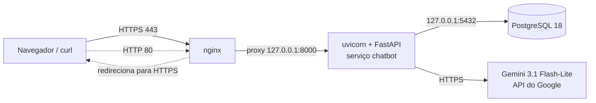

# Implantação no AWS EC2

Estado da implantação em **15/11/2026**. O levantamento da instância antes do deploy está em
`infra/instancia-ec2.md`.

## Endereços

| O quê | Endereço |
|---|---|
| Swagger | https://13.58.162.232/docs |
| Verificação de funcionamento | https://13.58.162.232/saude |

O certificado HTTPS é **autoassinado** (emitido para `13.58.162.232`, válido até 15/11/2027): o
navegador mostra um aviso de segurança na primeira visita, e é preciso aceitar para continuar. Com
`curl`, use `-k`.

## Arquitetura



Tudo roda direto na instância, sem Docker: com 908 MB de RAM, cada processo a menos conta.

| Componente | Detalhes |
|---|---|
| Sistema | Ubuntu 26.04, `t3.micro` (908 MB de RAM + **1 GB de swap** em `/swapfile`) |
| nginx 1.28 | Portas 80 (redireciona para HTTPS) e 443. Configuração: `/etc/nginx/sites-available/chatbot` |
| Aplicação | `/home/ubuntu/CHATBOT-TCA`, branch `dev`, ambiente virtual em `venv/`, Python 3.14 |
| Serviço | `chatbot.service` (systemd): só escuta em `127.0.0.1:8000`, reinicia sozinho se cair e sobe junto com a instância, depois do PostgreSQL |
| Banco | PostgreSQL 18 (pacote do Ubuntu), banco e usuário `chatbot`, só acessível de dentro da instância |
| Configuração | `/home/ubuntu/CHATBOT-TCA/.env` (permissão 600). Contém a senha do banco e a chave do Gemini: **nunca copie para o repositório** |

## Acesso SSH

A porta 22 só aceita os IPs liberados no *security group* da instância. Para ganhar acesso, informe
seu IP público (consulte em https://checkip.amazonaws.com) a quem administra a conta da AWS e peça
uma regra de entrada **SSH, TCP 22, origem `<seu IP>/32`**. Em conexão residencial o IP pode
mudar: se o SSH passar a expirar (*connection timed out*), confira o IP antes de tudo.

A chave `chatbot-key.pem` não é versionada (`.gitignore`): peça-a à equipe e guarde-a em `infra/`.

```bash
# A partir da pasta infra/ (no Git Bash do Windows funciona sem ajustar permissões)
chmod 400 chatbot-key.pem   # Linux/macOS
ssh -i chatbot-key.pem ubuntu@13.58.162.232
```

## Operação do dia a dia

### Publicar uma nova versão

Depois do merge na `dev`:

```bash
cd ~/CHATBOT-TCA
git pull --ff-only origin dev
venv/bin/pip install -r requirements.txt   # só se requirements.txt mudou
sudo systemctl restart chatbot
systemctl is-active chatbot                 # deve responder "active"
```

As tabelas que faltam são criadas na inicialização, mas **colunas novas em tabelas existentes não**:
se uma versão trouxer um script em `infra/migracao-*.sql`, rode-o antes de reiniciar:

```bash
sudo -u postgres psql -d chatbot -f infra/migracao-<nome>.sql
```

### Logs e diagnóstico

```bash
sudo journalctl -u chatbot -n 100 --no-pager   # últimas linhas, com os tracebacks
sudo journalctl -u chatbot -f                  # acompanhar em tempo real
systemctl status chatbot nginx postgresql
sudo -u postgres psql -d chatbot               # consultar o banco
```

O erro 500 público mostra só `Internal Server Error`: a causa sempre está no `journalctl`.

### Trocar o modelo ou outra configuração

Edite o `.env` (variáveis no README, seção de configuração) e reinicie o serviço:

```bash
nano ~/CHATBOT-TCA/.env
sudo systemctl restart chatbot
```

## Problemas já resolvidos

| Data | Sintoma | Causa | Correção |
|---|---|---|---|
| 15/11/2026 | `POST /conversa/mensagens` devolvia HTTP 500; `GET /conversa` funcionava | O primeiro deploy usava **SQLite** (`DATABASE_URL=sqlite+aiosqlite:///./chat.db`), porque o PostgreSQL não estava instalado. No SQLite, `BIGINT PRIMARY KEY` não gera ID automático, e todo `INSERT` em `mensagens` falhava (`NOT NULL constraint failed: mensagens.id`) | PostgreSQL instalado e `DATABASE_URL` apontado para ele. O `.env` antigo ficou em `.env.bak-sqlite`, e o `chat.db` (só conversas de teste) não foi apagado |
| 15/11/2026 | Pergunta gravada, mas resposta com evento `erro` | O Google recusa o `gemini-2.5-flash` para novos usuários (HTTP 404) | Modelo trocado para `gemini-3.1-flash-lite` (decisão 8 em `docs/elicitação dos requisitos.md`) |
| 15/11/2026 | Aplicação não voltaria após reiniciar a instância | Rodava com `nohup uvicorn` | Serviço `chatbot.service` no systemd |

O projeto foi feito para o **PostgreSQL**: não use SQLite, nem como paliativo.

## Pendências

- **Certificado confiável:** o Let's Encrypt exige um domínio. Com um domínio apontando para a
  instância, `certbot --nginx` substitui o certificado autoassinado.
- **IP fixo:** confirmar no console da AWS que `13.58.162.232` é um IP elástico; se não for, o
  endereço muda quando a instância é parada e iniciada.
- **Limite de gastos do Gemini:** criar um alerta de orçamento no Google Cloud
  (Billing → Budgets & alerts).
